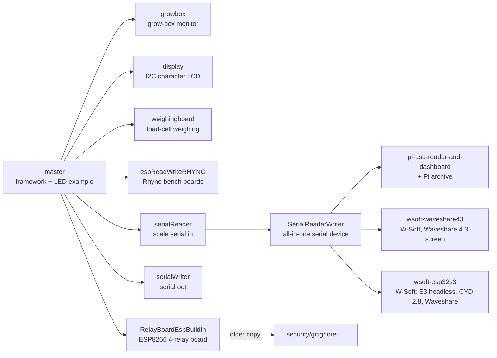

# Branch map: one Base, many devices

Snapshot: **18 November 2026**, after a branch clean-up. Every branch below was checked one by
one. Update this file when a branch is added, merged or retired.

## How it works

`master` is the shared ESP8266-React framework (Wi-Fi, hotspot, login, MQTT, OTA, web UI).
Each device type lives on its own long-lived branch that adds services under
`src/examples/<name>/`, web pages under `interface/src/project/`, and its board in
`platformio.ini`. Same base, different device. **Device code is never on `master`.**

## Device branches

| Branch | Device / purpose | Build envs | Last commit |
|---|---|---|---|
| `master` | Framework baseline. Start new device branches here. | `node32s` (also `esp12e`, `esp32dev`) | 4 Nov 2026 |
| `wsoft-esp32s3` | **W-Soft** (the main W-Soft line). Screenless ESP32-S3 N16R8 with web page, CYD 2.8" and Waveshare 4.3 screens, RS485 or RS232 scale, Hub pairing, Hi-Lo, Weigh/Writer roles. Carries every all-in-one serial feature. Was `claude/project-thread-9f4l7x` (renamed 18 Nov 2026). Docs: `docs/WSOFT-SCREEN.md`, `WSOFT-CYD28.md`, `WSOFT-WAVESHARE43.md` on that branch. | `wsoft_s3_headless`, `wsoft_cyd28`, `wsoft_waveshare43`, `native` tests (+ all-in-one envs) | 15 Nov 2026 |
| `wsoft-waveshare43` | W-Soft on the Waveshare 4.3 screen, 31 Oct work (PR #30). **Merged into `wsoft-esp32s3`** (18 Nov 2026); see `docs/WSOFT-WAVESHARE43.md` section 7 for where each feature went. Kept for history. | `wsoft_waveshare43` (+ all-in-one envs) | 2 Nov 2026 |
| `SerialReaderWriter` | All-in-one serial device: read a scale, forward weight, TFT or character-LCD screen per board. | `nodemcu_esp32` (+ firebeetle32, esp32s3, CYD, TFT, LCD envs) | 16 Jul 2026 |
| `pi-usb-reader-and-dashboard` | `SerialReaderWriter` + an archived Raspberry Pi USB scale reader and Node-RED dashboard (`pi-usb-reader-dashboard/`, Python, archive only). | as above | 15 Jul 2026 |
| `RelayBoardEspBuildIn` | **ESP8266 relay board** (ESP12F_Relay_X4): Live Weight, under/ok/over relays, ticket printer, products, weigh log, LAN discovery, 3D twin. See `docs/RELAY-BOARD-ESP-BUILT-IN.md` on that branch. | `esp12e` (+ `esp12e_ota`) | 10 Aug 2026 |
| `weighingboard` | Load-cell weighing board, OIML type-approval logic, zero/calibrate, PCB docs. | `node32s` | 29 Apr 2026 |
| `growbox` | Grow-box monitor: sensors + relays, Home Assistant MQTT. | `esp32s3` | 31 Mar 2026 |
| `display` | I2C character LCD, Wi-Fi auto-reconnect. | `node32s` | 29 Apr 2026 |
| `serialReader` | Read a scale over serial, forward weight. Base of the all-in-one line. | `esp32s3` | 29 Apr 2026 |
| `serialWriter` | Write weight out over serial; serial Wi-Fi bridge. | `esp32s3` | 29 Apr 2026 |
| `espReadWriteRHYNO` | Early serial + TFT work plus Rhyno's bench boards (FireBeetle, CYD 2.8", DevKit V1) and OTA targets. Holds the old `serial` branch. | `firebeetle32` | 2 May 2026 |

## Other branches

| Branch | What it is | State |
|---|---|---|
| `security/gitignore-device-config-and-credential-note` | Relay-board work stopped before `RelayBoardEspBuildIn`, plus one commit not in that branch (`7ac9bd5`: gitignore for device config + a credential note). | Keep until that commit is brought into `RelayBoardEspBuildIn` or dropped on purpose. |

## Tags

| Tag | Commit | What |
|---|---|---|
| `wsoft-s3-2026-11-18` | `cdda37a` | W-Soft firmware flashed on three site ESP32-S3 boards on 18 Nov 2026 (env `wsoft_s3_headless`). Flash guide: `Kruger-Web-Solutions/Weighsoft.WSoft` → `docs/esp/esp32s3-wsoft-flash.md`. |

## Clean-up on 18 Nov 2026

- **26 branches deleted.** Each was fully inside a branch that is kept (checked with
  `git branch -r --contains` and against its PR). They were finished task branches:
  W-Soft PRs #31–#53 (now in `wsoft-esp32s3`), the 31 Oct Waveshare work (in
  `wsoft-waveshare43`), the roadmap PR #26 (in `master`), the four `sprint-c/*` relay steps
  (in `RelayBoardEspBuildIn`), `serial` (in `espReadWriteRHYNO`) and `ALLinOneEspSerialdevice`
  (same code as `SerialReaderWriter`).
- The list with each branch's last commit is in `Kruger-Web-Solutions/Weighsoft.WSoft` →
  `docs/plans/2026-11-18-repo-cleanup-plan.md`. To bring one back:
  `git push origin <sha>:refs/heads/<name>`.
- `claude/project-thread-9f4l7x` renamed to `wsoft-esp32s3` (GitHub forwards the old name).

## Known gaps

1. ~~**Two W-Soft lines.**~~ Merged into `wsoft-esp32s3` on 18 Nov 2026 (one feature, clock from the Hub, left out on purpose).
2. **W-Soft sits on the all-in-one serial line**, so W-Soft firmware also builds serial
   reader/writer, relay and display code.
3. **The ESP32 relay board firmware lives in a separate repo**:
   `Kruger-Web-Solutions/Weighsoft-Relay-Control` (`main`, env `node32s`). `RelayBoardEspBuildIn`
   here is the ESP8266 relay board.
4. `master` is behind several device branches' merge base, so device branches miss the latest
   CI changes until they merge `master`.

## Rules for new work

Same as [INTEGRATION-WORKFLOW.md](INTEGRATION-WORKFLOW.md):

1. Shared framework change → branch from `master`.
2. Device change → branch from that device's branch above, then PR back into it.
3. New device → branch from `master`, add `src/examples/<name>/`, its pages, its env, and a row here.
4. Name task branches for what they do (`fix/…`, `feat/…`), and delete them once merged.
