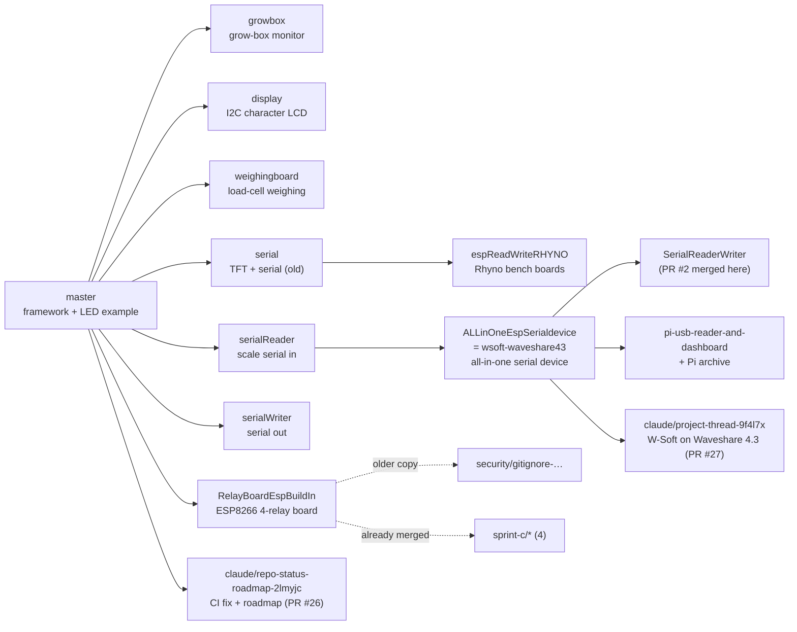

# Branch map: one Base, many devices

Snapshot: 31 October 2026. Every branch was checked one by one (last commit, what it adds on
top of `master`, build targets, web menu, open PRs). Update this file when a branch is added,
merged or retired.

## How it works

`master` is the shared ESP8266-React framework (Wi-Fi, hotspot, login, MQTT, OTA, web UI).
Each device type lives on its own long-lived branch that adds one or more services under
`src/examples/<name>/`, its web pages under `interface/src/project/`, and its board in
`platformio.ini`. Same base, different device.

## Device branches (the ones that matter)

| Branch | Device / purpose | Chip, default build env | Web menu | Last commit |
|---|---|---|---|---|
| `master` | Framework baseline. Start new device branches here. | ESP32 `node32s` (also `esp12e`, `esp32dev`) | LED Example | 23 Aug 2026 |
| `claude/project-thread-9f4l7x` | **W-Soft** weigh screen: Waveshare ESP32-S3 Touch LCD 4.3 + DJB-M1X over RS485. Also carries every all-in-one serial feature. Builds on Arduino-ESP32 3.x. See [WSOFT-WAVESHARE43.md](WSOFT-WAVESHARE43.md). | ESP32-S3 `wsoft_waveshare43` (+ 8 others, `native` tests) | LED, Serial, Diagnostics, Weight Forwarder, Remote Weight, LCD Display, W-Soft | 26 Oct 2026 |
| `ALLinOneEspSerialdevice` / `wsoft-waveshare43` | All-in-one serial device: read a scale, forward weight, TFT or character-LCD screen per board. Both names point at the **same commit**. | ESP32 `nodemcu_esp32` (+ firebeetle32, esp32s3, CYD, TFT, LCD envs) | LED, Serial, Diagnostics, Weight Forwarder, Remote Weight, LCD Display | 14 Jun 2026 |
| `SerialReaderWriter` | All-in-one above + PR #2 merge commit. Same code. | as above | as above | 16 Jul 2026 |
| `pi-usb-reader-and-dashboard` | All-in-one above + an archived Raspberry Pi USB scale reader and Node-RED dashboard (`pi-usb-reader-dashboard/`, Python, archive only). | as above | as above | 15 Jul 2026 |
| `RelayBoardEspBuildIn` | **ESP8266 relay board** (ESP12F_Relay_X4, 4 relays, 2 DIs): Live Weight, under/ok/over relays, network ticket printer, product catalog, weigh log CSV, LAN discovery, 3D digital twin. See `docs/RELAY-BOARD-ESP-BUILT-IN.md` on that branch. PRs #3–#24 (closed) built it. | ESP8266 `esp12e` (+ `esp12e_ota`) | Relay Board Twin, Live Weight | 10 Aug 2026 |
| `weighingboard` | Load-cell weighing board with OIML type-approval logic, zero/calibrate, PCB docs (`docs/pcb`). | ESP32 `node32s` | LED Example, Weighing | 29 Apr 2026 |
| `growbox` | Grow-box monitor: sensors + relays, Home Assistant MQTT. One commit on master. | ESP32-S3 `esp32s3` | Growbox, LED Example | 31 Mar 2026 |
| `display` | I2C character LCD (LiquidCrystal_I2C), Wi-Fi auto-reconnect. | ESP32 `node32s` | LED, Display | 29 Apr 2026 |
| `serialReader` | Read a scale over serial, forward weight (ESP32-S3 WebSocket fixes). Became the base of the all-in-one branch. | ESP32-S3 `esp32s3` | LED, Serial, Diagnostics, Weight Forwarder | 29 Apr 2026 |
| `serialWriter` | Write weight out over serial; serial Wi-Fi bridge use cases. | ESP32-S3 `esp32s3` | LED, Serial Writer, Serial Reader Source, Diagnostics | 29 Apr 2026 |
| `serial` | Early serial + 3.5" TFT (ILI9488) work. Historical. | ESP32 `firebeetle32` | LED, Serial, Diagnostics, Weight Forwarder, Remote Weight | 29 Mar 2026 |
| `espReadWriteRHYNO` | `serial` + Rhyno's bench boards (FireBeetle, CYD 2.8", plain DevKit V1) and OTA targets. | ESP32 `firebeetle32` | LED, Serial, Diagnostics, Weight Forwarder, Remote Weight | 2 May 2026 |

## Work branches (not device baselines)

| Branch | What it is | State |
|---|---|---|
| `claude/repo-status-roadmap-2lmyjc` | CI fix for the ESP32 build, stop committing device passwords, roadmap. | Draft PR #26 into `master` |
| `security/gitignore-device-config-and-credential-note` | Relay-board work stopped 8 commits before `RelayBoardEspBuildIn`, plus a gitignore for device config. | No PR. Check whether the gitignore is in the relay branch before deleting. |
| `sprint-c/phase-1-4-discovery`, `sprint-c/phase-2-udp-bind-fix`, `sprint-c/phase-2-discovery-rest-probe`, `sprint-c/phase-2-discovery-json-fix` | Relay-board discovery sprint steps (PRs #12–#15). | Fully contained in `RelayBoardEspBuildIn`. Safe to delete. |

## Open pull requests

| PR | From → into | What |
|---|---|---|
| #27 (draft) | `claude/project-thread-9f4l7x` → `wsoft-waveshare43` | W-Soft as Base services on the Waveshare ESP32-S3 4.3 |
| #26 (draft) | `claude/repo-status-roadmap-2lmyjc` → `master` | CI fix, no device passwords, roadmap |

PRs #1–#25 are closed. The relay-board PRs (#3–#24) show as closed, not merged, but their
commits are in `RelayBoardEspBuildIn`.

## Known gaps

1. **The ESP32 relay board's firmware lives in a separate repo, not in this one.** On 31 Oct 2026
   the relay board at `192.168.1.11` reported an **ESP32** with menu *Information, Relay Control,
   Configuration, MQTT Settings, REST API Test*. That exact menu is in
   `Kruger-Web-Solutions/Weighsoft-Relay-Control` (`main`, env `node32s`), a separate copy of the
   same ESP8266-React base. `RelayBoardEspBuildIn` here is the **ESP8266** relay board. To follow
   "one Base, many devices", that repo should become a device branch here.
2. Duplicate names: `ALLinOneEspSerialdevice` = `wsoft-waveshare43` (same commit), and
   `SerialReaderWriter` only adds a merge commit. Pick one name.
3. Branches named in older docs that do not exist: `serial2`, `display35`.
4. `master` is 21–24 commits behind several device branches' merge base, so device branches
   miss the latest CI changes until they merge `master`.

## Rules for new work

Same as [INTEGRATION-WORKFLOW.md](INTEGRATION-WORKFLOW.md):

1. Shared framework change → branch from `master`.
2. Device change → branch from that device's branch in the table above, then PR back into it.
3. New device → branch from `master`, add `src/examples/<name>/`, its pages, its env, and a row here.
