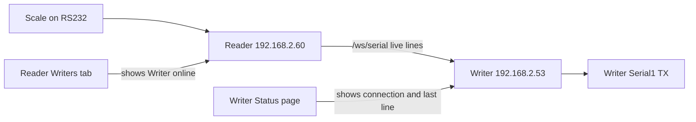

# Reader to Writer Setup

## Reader and Writer in plain words

Every ESP has **one** serial port, so it plays **one** role. Pick it on **Serial > Information** (top switch).

| Role | Short name | What it does | Wires |
| --- | --- | --- | --- |
| **Reader** | scale in | A scale is wired to this ESP. It listens, finds the weight in each line, and shares it over Wi-Fi (web page, MQTT, live stream, and any Writer). | Scale TX → ESP RX, GND → GND |
| **Writer** | data out | No scale here. It takes the lines from a Reader over Wi-Fi and sends them out of its TX pin to a printer, big display or PC. | ESP TX → device RX, GND → GND |

```text
  SCALE ──wire──▶ [ READER ESP ] ~~~ Wi-Fi ~~~▶ [ WRITER ESP ] ──wire──▶ PRINTER / DISPLAY / PC
         scale in                                              data out
```

Pins (from the code, not new):

| Board | Reader listens on (RX) | Writer sends on (TX) |
| --- | --- | --- |
| ESP32-S3 boards | GPIO18 (`SERIAL2_RX_PIN`, `SerialService.h`) | GPIO17 (`SERIALW_TX_PIN`, `SerialWriterService.h`) |
| Yellow 2.8" CYD | GPIO22 on CN1 (`platformio.ini`) | GPIO17 (the code uses the same pin on every board) |

- A real RS232 device swings up to ±12 V: put a 3.3 V RS232-to-TTL converter (MAX3232) between it and the ESP pins.
- W-Soft boards have their own two roles, **Weigh** and **Writer**: see the next section.

This checklist connects one Reader device to one Writer device with the Serial Reader Source feature.

## W-Soft: one board, two roles (Weigh or Writer)

Rhyno's design (12 Nov 2026): every board is the same W-Soft device with one switch.
The word "Reader" is not used on W-Soft boards.

```text
  SCALE ─▶ [ W-SOFT  "Weigh" ] ~~~ Wi-Fi ~~~▶ [ W-SOFT  "Writer" ] ─▶ PRINTER / BIG DISPLAY / PC
           reads, saves, Hub                   shows, formats, sends
           (port A)                            (port B)

                 both boards show on the Hub ONCE each; only the Weigh board saves
```

| | **Weigh** (default) | **Writer** |
| --- | --- | --- |
| Port | Reads the scale (RS485 card or RS232 scale) | Sends the weight out (same plug) |
| Weight comes from | Its own scale | A Weigh board over Wi-Fi (`/ws/wsoftFeed`) |
| Saves weighings | Yes (SAVE, Auto save) | **Never** (`WSOFT_SAVE_WRITER`), so nothing is counted twice |
| Hub | Heartbeats + weighings | Heartbeats only; the pairing stays when you flip the switch |
| Hi-Lo relays | Follow the zone | Off, unless "In Writer mode, switch the relays too" is on |
| Product | Picked on its screen, its **W-Soft › Products** page, or by the Hub | Follows the weigh board's product (feed field `product`); a code it does not hold = no product, so add the same board product on both boards |
| Screen header | `RS485 LIVE` / `RS232 LIVE` | `WRITER LIVE`, or `NO WEIGH BOARD` |

How to set it up:

1. **Weigh board:** nothing new. It now also shares its weight, open and read-only, on
   `GET /rest/wsoftFeed` and the `/ws/wsoftFeed` socket (`last_line`, `weight`, `unit`, `stable`, `timestamp`,
   every 0.5 s). With a tare on, the feed carries the **net** weight, as the screen shows it (Rhyno, 14 Nov 2026).
2. **Writer board:** **Serial** page, top switch, pick **Writer (follows a weigh board)**. The board restarts.
3. **Serial > Settings, Step 1:** pick the weigh board from the list (or type its address), press **Save and Test Connection**.
4. **Step 2, weight format:** leave `{line}` to send `12.345 kg` as it is, or shape it, for example
   `{stable},GS,{weight} {unit}` gives `ST,GS,12.345 kg`. Fields: `{line}` `{weight}` `{unit}` `{stable}`.
5. **Step 3, wiring:** the Writer sends out of the board's scale plug. Yellow CYD: CN1 GPIO27 (TX) through the MAX3232.
   Waveshare: the RS485 terminals. Set baud and format to match the receiving device.

Notes:

- The role is saved in its own file (`/config/wsoftRole.json`), so a mode saved by older firmware never turns a
  weigh board into a Writer. No file = Weigh. The hotspot name stays `Weighsoft-Esp-Reader` on a weigh board.
- On a W-Soft Writer the USB port keeps the logs and the HUB / APPROVAL commands; the Writer never sends on USB.
- A Writer stops reading its own scale (one port). Switching back to Weigh restarts the board and it weighs again.
- Weighings still waiting for the Hub when a board becomes a Writer are still sent.

## Known Bench Devices

| Role | Address | Purpose |
| --- | --- | --- |
| Reader | `http://192.168.2.60/` | Scale is connected here. It serves live serial lines from `/ws/serial`. |
| Writer | `http://192.168.2.53/` | Serial output device is connected here. It pulls lines from the Reader and writes them out. |

## Reader, Writer and the Weighsoft Hub

The Reader/Writer role is only about who owns the one serial port. It is **not** a Hub setting.

| Board build | Talks to the Hub? | How |
| --- | --- | --- |
| **W-Soft** (`FT_WSOFT`: `wsoft_cyd28`, `wsoft_waveshare43`), Weigh or Writer | **Yes** | `lib/wsoft_esp/src/hub.cpp`: signed heartbeat (`/api/v1/ingest/heartbeats`), saved weighings (`/ingest/weighings`, Weigh only), board switches (`/ingest/commands`), Hi-Lo products (`/ingest/hilo`). Paired on the **Hub** menu item (admin only; the old W-Soft > Hub link leads there). |
| Plain **Reader** ESP (no W-Soft) | **No** | Shares the weight over its own page, MQTT, live stream, the Weight Forwarder and Writers. No Hub code in these builds. |
| Plain **Writer** ESP | **No** | Only takes lines from a Reader and sends them out of TX. |

What the Hub does with a W-Soft board (Weighsoft.Indicator.Hub): **status** from heartbeats (Fleet, Device, Device health, alerts),
**reports** from the weighings (daily per scale and product, CSV), **setup** it sends down (products, Hi-Lo limits, Approval / Auto save switches).
A W-Soft Writer shows on the Hub as its own device (its own pairing), with heartbeats only. The Hub needs no change.

## Known gaps (12 Nov 2026)

| Gap | Effect | State |
| --- | --- | --- |
| The Serial menu shows on every `wsoft_cyd28` build (compile flag), but the Serial reader runs only when W-Soft's source is RS232. | On RS485 the page called a service that is not there. | **Fixed in PR #42**: the page now says the reader is off and points to W-Soft > Settings. |
| `SERIALW_TX_PIN` 17 and `DIAG_*_PIN` 18/17 are their own copies; only the reader pins follow a board's `SERIAL2_*_PIN`. | On plain CYD / `esp32dev_tft` builds a Writer or Diagnostics would use 18/17, not the board's serial pads. | **Fixed for W-Soft** (`SERIALW_*_PIN` set per W-Soft board in `platformio.ini`). Open for the plain builds. |
| Heartbeat health names the link `djb_link` / `djb_weight` also on an RS232 scale or a Writer. | The Hub's raw health view says "djb". Values are right. | Open: rename needs a Hub + board change together. |
| A W-Soft board that once saved mode `writer` keeps that word in its hotspot name and mDNS. | Cosmetic. | **Fixed**: W-Soft keeps its role in its own file. |
| The Writer used to sign in to the Reader with the factory admin password over plain HTTP. | A password in the code, sent on the network, for feeds that are open anyway. | **Removed**: `/ws/serial`, `/rest/serial` and `/rest/writers` need no login since May 2026. A Reader on firmware older than May 2026 must be updated. |
| The backup REST poll could send the same line twice. | A duplicate print / display line. | **Fixed**: a line with the same `timestamp` is sent once. |
| The heartbeat does not say Weigh or Writer. | The Hub cannot show "Writer" yet. | Open (optional field, Hub + board together). |

## Setup Steps

1. Open the Writer UI at `http://192.168.2.53/`.
2. Go to **Serial > Settings**.
3. In **Step 1: Data in (from the Reader)**, paste the Reader web address: `http://192.168.2.60/`.
4. Click **Save Reader and Test Connection**.
5. Confirm the Writer banner turns green and says it is connected to `192.168.2.60`.
6. Open the Reader UI at `http://192.168.2.60/`.
7. Go to **Serial > Writers** and confirm the Writer appears online.

The Writer accepts either the web address (`http://192.168.2.60/`) or the WebSocket address (`ws://192.168.2.60/ws/serial`). The UI normalizes the web address to the live serial WebSocket endpoint when saving.

## Quick Test

1. Keep both devices powered and on the same WiFi network.
2. Send scale data into the Reader.
3. On the Writer, open **Serial > Status**.
4. Confirm **Serial Reader connection** is green and **Last received** shows the latest scale line.
5. Confirm **Writer output** shows the last sent line with source `reader`.

## Troubleshooting

| Symptom | Check |
| --- | --- |
| Writer says no Reader is set up | Open Writer **Serial > Settings > Step 1**, paste the Reader address, and click **Save Reader and Test Connection**. |
| Writer keeps reconnecting | Confirm the Reader is powered, reachable at `http://192.168.2.60/`, and in Reader mode. |
| Reader does not list the Writer | Confirm the Writer Source URL points to the Reader and the Writer banner is green. |
| Writer connects but no data appears | Confirm the scale is sending data into Reader GPIO18 and Reader **Live Stream** shows lines. |
| Writer receives data but output device is quiet | Confirm Writer wiring (ESP TX → device RX, GND → GND), baud rate, data bits, parity, stop bits, and line ending under **Serial > Settings**. |

## Expected Data Flow



## W-Soft: products made on the board (13 Nov 2026)

**W-Soft › Products** lists every product the board can use:

| From | Where it is made | On the board |
| --- | --- | --- |
| **Hub** | Hub › Setup › Products (limits on the NONE container) | Read-only (lock icon). Pulled every 60 s, up to 50. |
| **This board** | Here: code, name, Low / Target / High in kg | Add, edit, delete. Up to 20, kept in flash (NVS `hilo`, key `local`). Works with no Hub. |

- Admins add, edit, delete and **Use** products; other users only see the list.
- Rules (board and page): code `[A-Za-z0-9_-]{1,32}`, name 1 to 24 plain characters, 0 < Low < High,
  Low ≤ Target ≤ High. A code the Hub already uses is refused ("That code belongs to the Hub").
- If the Hub later adds the same code, the Hub product wins and the board one shows as **Hidden (Hub code)**.
- The screen's MENU › PRODUCT steps through Hub products, then board products, then no product.
- Board products are **not sent to the Hub as products**. Every weighing still carries the product code,
  target and limits, and the Hub shows which product is in use, so reports keep working.
  Sending board products up to the Hub's product list is a later step (needs a Hub change).
- API: `GET /rest/wsoftProducts` (logged in), `POST /rest/wsoftProducts` (admin) with
  `{"action":"put"|"delete"|"use",...}`; see `src/examples/wsoft/WSoftProductsService.h`.
