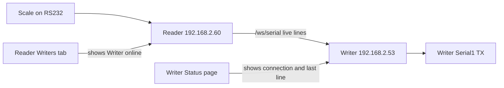

# Reader to Writer Setup

## Reader and Writer in plain words

Every ESP has **one** serial port, so it plays **one** role. Pick it on **Serial > Information** (top switch).

| Role | Short name | What it does | Wires |
| --- | --- | --- | --- |
| **Reader** | scale in | A scale is wired to this ESP. It listens, finds the weight in each line, and shares it over Wi-Fi (web page, MQTT, live stream, and any Writer). | Scale TX → ESP RX, GND → GND |
| **Writer** | data out | No scale here. It takes the lines from a Reader over Wi-Fi and sends them out of its TX pin to a printer, big display or PC. | ESP TX → device RX, GND → GND |

```text
  SCALE ──wire──▶ [ READER ESP ] ~~~ Wi-Fi ~~~▶ [ WRITER ESP ] ──wire──▶ PRINTER / DISPLAY / PC
         scale in                                              data out
```

Pins (from the code, not new):

| Board | Reader listens on (RX) | Writer sends on (TX) |
| --- | --- | --- |
| ESP32-S3 boards | GPIO18 (`SERIAL2_RX_PIN`, `SerialService.h`) | GPIO17 (`SERIALW_TX_PIN`, `SerialWriterService.h`) |
| Yellow 2.8" CYD | GPIO22 on CN1 (`platformio.ini`) | GPIO17 (the code uses the same pin on every board) |

- A real RS232 device swings up to ±12 V: put a 3.3 V RS232-to-TTL converter (MAX3232) between it and the ESP pins.
- **W-Soft boards are always a Reader.** Their one serial port reads the scale, the Writer service is not built there,
  so the web page greys out Writer and hides the Writers tab.

This checklist connects one Reader device to one Writer device with the Serial Reader Source feature.

## Known Bench Devices

| Role | Address | Purpose |
| --- | --- | --- |
| Reader | `http://192.168.2.60/` | Scale is connected here. It serves live serial lines from `/ws/serial`. |
| Writer | `http://192.168.2.53/` | Serial output device is connected here. It pulls lines from the Reader and writes them out. |

## Reader, Writer and the Weighsoft Hub

The Reader/Writer role is only about who owns the one serial port. It is **not** a Hub setting.

| Board build | Talks to the Hub? | How |
| --- | --- | --- |
| **W-Soft** (`FT_WSOFT`: `wsoft_cyd28`, `wsoft_waveshare43`) | **Yes** | `lib/wsoft_esp/src/hub.cpp`: signed heartbeat (`/api/v1/ingest/heartbeats`), saved weighings (`/ingest/weighings`), board switches (`/ingest/commands`), Hi-Lo products (`/ingest/hilo`). Paired on the **Hub** menu item (admin only; the old W-Soft > Hub link leads there). |
| Plain **Reader** ESP (no W-Soft) | **No** | Shares the weight over its own page, MQTT, live stream, the Weight Forwarder and Writers. No Hub code in these builds. |
| Plain **Writer** ESP | **No** | Only takes lines from a Reader and sends them out of TX. |

What the Hub does with a W-Soft board (Weighsoft.Indicator.Hub): **status** from heartbeats (Fleet, Device, Device health, alerts),
**reports** from the weighings (daily per scale and product, CSV), **setup** it sends down (products, Hi-Lo limits, Approval / Auto save switches).
The Hub does not know or care whether the board is a "Reader": a W-Soft board is always one.

## Known gaps (12 Nov 2026)

| Gap | Effect | State |
| --- | --- | --- |
| The Serial menu shows on every `wsoft_cyd28` build (compile flag), but the Serial reader runs only when W-Soft's source is RS232. | On RS485 the page called a service that is not there. | **Fixed in PR #42**: the page now says the reader is off and points to W-Soft > Settings. |
| `SERIALW_TX_PIN` 17 and `DIAG_*_PIN` 18/17 are their own copies; only the reader pins follow a board's `SERIAL2_*_PIN`. | On CYD / `esp32dev_tft` builds a Writer or Diagnostics would use 18/17, not the board's serial pads. W-Soft builds are not affected (no Writer). | Open: a pin decision for Rhyno. |
| Heartbeat health names the link `djb_link` / `djb_weight` also on an RS232 scale. | The Hub's raw health view says "djb" for an RS232 board. Values are right. | Open: rename needs a Hub + board change together. |
| A W-Soft board that once saved mode `writer` keeps that word in its hotspot name and mDNS. | Cosmetic only; the page now always shows Reader. | Open, low. |

## Setup Steps

1. Open the Writer UI at `http://192.168.2.53/`.
2. Go to **Serial > Settings**.
3. In **Step 1: Data in (from the Reader)**, paste the Reader web address: `http://192.168.2.60/`.
4. Click **Save Reader and Test Connection**.
5. Confirm the Writer banner turns green and says it is connected to `192.168.2.60`.
6. Open the Reader UI at `http://192.168.2.60/`.
7. Go to **Serial > Writers** and confirm the Writer appears online.

The Writer accepts either the web address (`http://192.168.2.60/`) or the WebSocket address (`ws://192.168.2.60/ws/serial`). The UI normalizes the web address to the live serial WebSocket endpoint when saving.

## Quick Test

1. Keep both devices powered and on the same WiFi network.
2. Send scale data into the Reader.
3. On the Writer, open **Serial > Status**.
4. Confirm **Serial Reader connection** is green and **Last received** shows the latest scale line.
5. Confirm **Writer output** shows the last sent line with source `reader`.

## Troubleshooting

| Symptom | Check |
| --- | --- |
| Writer says no Reader is set up | Open Writer **Serial > Settings > Step 1**, paste the Reader address, and click **Save Reader and Test Connection**. |
| Writer keeps reconnecting | Confirm the Reader is powered, reachable at `http://192.168.2.60/`, and in Reader mode. |
| Reader does not list the Writer | Confirm the Writer Source URL points to the Reader and the Writer banner is green. |
| Writer connects but no data appears | Confirm the scale is sending data into Reader GPIO18 and Reader **Live Stream** shows lines. |
| Writer receives data but output device is quiet | Confirm Writer wiring (ESP TX → device RX, GND → GND), baud rate, data bits, parity, stop bits, and line ending under **Serial > Settings**. |

## Expected Data Flow


