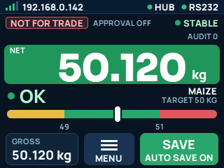

# W-Soft on the small yellow board (`wsoft_cyd28`)

Sunton ESP32-2432S028 ("Cheap Yellow Display", CYD): ESP32-WROOM-32, 4 MB flash, no PSRAM,
2.8" 320x240 panel (ST7789 on the TPM408-2.8 batch, ILI9341 on older ones) with XPT2046 touch (touch not used). Same W-Soft code as the Waveshare
build ([WSOFT-WAVESHARE43.md](WSOFT-WAVESHARE43.md)): approval, Hub queue, DJB poll,
web pages. Only the panel drawing and the pins differ (`WSOFT_BOARD_CYD` in
`lib/wsoft_esp/src/wsoft_screen.cpp`).

> Nothing on this device is legal for trade. Approval stays OFF until Rhyno switches it on
> over USB.

## 1. RS485: needs an add-on

The CYD has no RS485 transceiver. Use a **3.3 V TTL-to-RS485 module with automatic
direction** (no DE/RE pin to drive). Wire it to the **CN1** connector:

| CN1 pin | Module pin |
|---|---|
| 3V3 | VCC |
| GND | GND |
| GPIO22 | the module's TX / TXD / "RO" output (data **from** the box) |
| GPIO27 | the module's RX / RXD / "DI" input (data **to** the box) |

Module A/B go to the junction box A/B. The pins are build flags (`WSOFT_RS485_RX`,
`WSOFT_RS485_TX`); GPIO22/27 are the CN1 pads the `cyd28` env already used for a scale UART.
**Check the module's own labels before power-on**: some modules name TX/RX from their
own side, some from the ESP's side. If the screen stays on `NO SIGNAL`, swap the two data
wires (it cannot damage a 3.3 V module).

Only one RS485 master on the pair: unplug any other reader (Pi, Waveshare) from the box first.

## 1b. RS232 scale instead of the junction box

W-Soft → **Settings** → **Weight comes from**: *Junction box (RS485)* (default) or
*RS232 scale*. Saving a new choice restarts the board (both use the same UART on CN1).

In RS232 mode the existing **Serial reader** (`SerialService`, the same one the other
Hardware.Base boards use) owns the UART on CN1 (`SERIAL2_RX_PIN=22`, `SERIAL2_TX_PIN=27`).
Set the scale's baud, data bits, parity and the **weight pattern** (a regex whose first
group is the number) on the **Serial** page. W-Soft takes that extracted text, parses it
(`wsoft_parse_weight_text`: sign, digits, `.` or `,`, up to 4 decimals; anything else is
not a weight), and runs the same screen, stability and approval checks on it. Unit is kg;
there is no box alarm. A line older than 3 s is `NO SIGNAL`. DJB register jobs
(`/rest/djb`) answer 409 `NO_CARD` ("No weighing card: the scale is on RS232."). The scale
setup is then set on the indicator, so Approval can go ON without a board setup.

**The CYD has no RS232 chip.** Its `P1` plug (VIN/TX/RX/GND) is 3.3 V serial and shares
the USB line. A real RS232 scale (up to ±12 V) needs a **3.3 V RS232-to-TTL converter
(MAX3232)** on CN1: converter TTL side to CN1 like the RS485 module above, DB9 side to the
scale.

## 1c. Load cell on an HX711 board (no scale indicator)

W-Soft → **Settings** → **Weight comes from**: *Load cell (HX711 board)*. Saving restarts the
board. The board then reads the load cell itself; nothing uses the UART on CN1, so there is
no RS485 box and no RS232 scale on this board in that mode. The weight still goes to the
screen, the web page, the Hub and a Writer over Wi-Fi, like any other source.

> **On the bench 22 Nov 2026:** Rhyno's yellow board weighs with the HW-29 board on CN1
> (commit c142c76), and the print next to the plug on his board reads GND, IO22, IO27, 3.3V.
> Not measured yet: accuracy, drift, and the scale setup below (added after that run).

**Wiring (CN1, 4 wires, no soldering).** Rhyno's board is the green `HW-29` HX711 module.

| HX711 board (bottom row, `JP2`) | CN1 pin |
|---|---|
| VCC | 3V3 |
| GND | GND |
| DT | GPIO22 |
| SCK | GPIO27 |

- **VCC goes to 3.3 V, never 5 V.** The DT signal is at the HX711's supply voltage, and an
  ESP32 pin takes 3.3 V.
- The load cell goes on the top row (`J1`): E+ / E- feed it, A+ / A- are its signal. B+ / B-
  stay empty (channel B is not read).
- The CN1 pin names are from the community pin list for this board
  (witnessmenow/ESP32-Cheap-Yellow-Display `PINS.md`): read the print next to the plug.
- The pins are build flags: `WSOFT_HAS_LOADCELL`, `WSOFT_LOADCELL_DT`, `WSOFT_LOADCELL_SCK`.
  Only this env sets them, so only this board offers the choice.

**What the code does** (`lib/wsoft_esp/src/loadcell.cpp`, rules in
`lib/wsoft_core/src/wsoft_loadcell.cpp`, host tests `test/test_wsoft_loadcell`):

- From the HX711 datasheet: DT low = a count is ready; 24 clock pulses read it (24-bit two's
  complement), a 25th picks channel A at gain 128. The 25 pulses run with interrupts off,
  because a clock pulse held high for 60 us or more puts the chip to sleep.
- Our own choices, not datasheet values: the filter (below); no count for 1 s = `NO SIGNAL`; a
  test weight must move the count by at least 1000.
- **Filter** (Rhyno, 22 Nov 2026: the reading was not steady). The counts of each tenth of a
  second are first gathered into one, so everything below works the same whether the chip runs
  at 10 or 80 counts a second (the Calibrate page shows the measured *Chip speed*). *Off* shows
  each of those as it comes. *Low*, *Medium* (the default) and *High* average the last 4, 12 or
  32 of them (0.4, 1.2, 3.2 s), and do
  two more things: a count more than 4 divisions from the average is a new load, not noise (one
  alone is dropped as a spike, a second on the same side starts the average again from those
  two, so a long average still follows a new load at once; when the counts are themselves
  further apart than that, their spread is the limit); and the last digit is held until
  the load is more than 3/4 of a division from the weight shown, so a load on the edge between
  two divisions does not flip between them. The screen and the web page show the same held
  weight. On the bench 22 Nov (f84c076, before the tenth-of-a-second step, Medium, empty, 30 s):
  the reading held inside 2 divisions, with one blip of 8 divisions getting through.
- **Auto zero** (zero tracking; off by default). Set to 1, 2 or 3 divisions: while the load has
  stayed that close to zero for 2 seconds, the zero follows it (an eighth of what is left, ten
  times a second). Kept in memory only, cleared by a restart or a new zero, and never more than
  20 divisions from the set zero. It also takes away a small load left inside that band. Our
  own choices; not tried on a board yet.
- **Drift Guard** (off by default; 1 to 20 divisions). Bench, 22 Nov (28f8624, 0.002 kg division,
  hands off): a slow wave of about 12 g, the same size empty and with 0.5 kg on, no spikes. With
  a load on, the board sees one number and cannot tell the zero floating from a slow real change.
  So: once the count has stayed within one division for 2 seconds, slow movement is held back
  and the weight shown stands still. It lets go, and shows the whole weight, when one filtered
  count moves more than half a division, or when the amount held back would pass the limit.
  Near zero with Auto zero on it does nothing. It rests while Approval is ON. Kept in memory
  only. The price: a slow change smaller than the limit stays hidden until the next release.
  Our own choices; host-tested (`test_wsoft_loadcell`). First bench run (d07b1b0, limit unknown,
  0.5 kg, 30 s): band 6 g, was 12 g; whether it was switched on could not be seen from the cable.
- **On the cable** (USB, like `SCREEN`): `LOADCELL INFO` prints the setup and what auto zero and
  Drift Guard are doing (holding, counts held back, how often it began to hold and let go for a
  jump or for the limit). `LOADCELL SET dec= step= filter= auto_zero= drift_guard=` changes the
  setup like the Scale setup tab; refused while Approval is ON. The start line and a
  `LOADCELL_STATE` line next to every weight line carry the same facts.
- The chip's two end values (out of range) are never a weight.
- Whether this module runs at 10 or 80 counts a second is set on its board and was not checked.
  The code works with either.

**Scale setup** (W-Soft → **Scale setup**, admin). One tab holds the setup on every source
(Rhyno, 22 Nov 2026: one home, no double). On RS232 it says the indicator holds it; on RS485
the decimals and e go to the weighing card; with a load cell the board is the scale, so the
same form shows *Unit* (kg or g), *Division size* (1, 2 or 5 in any digit from 0.0001 kg or
0.01 g up, then 10, 20, 50), *Filter* and *Auto zero* in the place of the card's two fields. Under the
filter the page says how big the raw noise is now, in divisions, and which filter fits (a rough
estimate of ours: up to 1 division Low, 1.7 Medium, 2.8 High, more = pick a bigger division).
One range; a second range is not built. They are saved with `POST /rest/wsoftLoadcell
{"action":"format","decimals":3,"step":2,"unit":"kg","filter":2,"zero_track":1}` (= 0.002 kg,
Medium, auto zero within 1 division; filter 0 off .. 3 high, zero_track 0 off .. 3); the rest of the form is the RS485 one (section 2c): Max,
Min, blanking below zero and above Max, stable samples, tare, the SA number, and "setup
complete" before Approval can go ON. The board hands its own division, decimals and unit to
those rules in the place of the card's (`scale_set_card`). The g unit stops at 0.01 g because
those rules count in 0.00001 kg. The screen gets the TARE tiles and the plate line, as on RS485
(not tried on a board yet).

**ZERO on the screen** (load cell only; Rhyno, 22 Nov 2026). It is on the live page, where
GROSS is on the other boards (with no tare on, gross is the big number anyway; under a tare
the GROSS read-out is back), and in MENU → **ZERO**. Under the button the screen says what the
tap did for 3 seconds (`ZERO SET`, `NOT STEADY`, `APPROVAL IS ON`). The status bar says `CELL`. The scale
drifted off zero: empty it, tap ZERO. It is the same zero as on the Calibrate tab, kept over a
restart. Refused with Approval ON (`APPROVAL IS ON`), while a tare is on, and while the reading
is not steady. A board that reads a scale (RS485, RS232) has no ZERO tile: that scale keeps its
own zero. The menu holds 7 tiles; with ZERO and PRESET TARE both there the WI-FI tile gives
way (a tap on the Wi-Fi bars at the top opens the same page). Not tried on a board yet.

**Calibrate** (W-Soft → **Calibrate**, admin; `GET` / `POST /rest/wsoftLoadcell`):

1. **Zero**: scale empty, *Set zero*.
2. **Test weight**: put a known weight on, type what it weighs, *Set test weight*. It is kept in
   the scale's own digits (`2` on a 0.001 kg scale = 2000); more digits than the division has
   are refused. Changing the division later keeps the calibration when the test weight still
   fits the new last digit, and is refused (`format_span`) when it does not.

The page shows the **internal count** (the raw count from the chip, through the filter) under
the weight, asked for about four times a second, and how far it is from the stored zero. It is
there before any calibration: press on the load cell and it moves.
That checks the wiring. Once calibrated it also shows **Noise**: how far the last counts (up to
32) are apart, in divisions. Until zero and a test weight are set the board shows no weight at all.
The calibration is kept on the board (NVS `loadcell`) and each change is one `LOADCELL ...`
line in the USB log. All of it is refused while Approval is ON. No junction box alarm. A
weighing sent to the Hub carries `"source":"loadcell"`.

## 2. Screen (320 x 240)

The same screen as on the Waveshare, in the look of the Edge bench screen, light or dark:
[WSOFT-SCREEN.md](WSOFT-SCREEN.md) says what every part shows, how MENU and the Wi-Fi alert work,
how it is built and how to check a board over USB (`SCREEN CRC`, `SCREEN SHOT`, `SCREEN TAP`).

This board has no memory for a whole frame. A row of the screen is drawn 16 lines at a time and
pushed over SPI; a row is drawn again only when what it shows changed, so nothing flickers.

CYD batches use different panel controllers. The env defaults to the TPM408-2.8 bench
board: `-DST7789_DRIVER=1`, `-DTFT_RGB_ORDER=TFT_BGR`, `WSOFT_CYD_ROTATION=3`,
`WSOFT_CYD_INVERT=0`.

| What the screen shows | Change |
|---|---|
| Sideways, cut off, a noisy strip on one side | wrong controller: swap `ST7789_DRIVER` / `ILI9341_DRIVER` |
| The colours are the negative of the pictures in [img/wsoft-screen](img/wsoft-screen) (a pale status bar; a white screen in dark mode) | flip `WSOFT_CYD_INVERT` |
| Upside down | `WSOFT_CYD_ROTATION=1` |
| Red shows as blue | flip `TFT_RGB_ORDER` between `TFT_BGR` and `TFT_RGB` |

First flash (3 Nov 2026) with ILI9341 + invert on drew sideways, clipped, with an 80 px
noise strip and a dark background.

## 2b. Weighings for the Hub

A weighing is saved when someone taps **SAVE** (on the screen, or **Save weighing** on the
web Live page), or by itself when **Auto save** is on (the switches: screen MENU, the web page, the Hub or
`/rest/wsoftSwitches`; off by default, kept in NVS `weigh`).
Either way only once the weight has settled above zero for 1 s, and once per load: a new
load needs the scale back at **0** first (also after a restart). A changed weight alone is
not a new load (Rhyno, 8 Nov 2026). Saved whether trade checks are on or
not; the payload carries `for_trade`.

- The SAVE button shows `SAVED #n`, or why not (`Wait: moving`, `Already saved`, `Take load off`,
  `Scale is empty`, `No scale signal`, `Clock not set`, `Memory full`) for 3 s, then how
  many wait for the Hub. After a save it says `Take load off` while that load stays on.
- **Big notice over the weight** (Rhyno, 9 Nov 2026): whenever something stops a save, a
  band across the top of the card says what to do and why, without a tap. Red = nothing saves
  until you act: `TAKE THE LOAD OFF` (the scale must show 0 kg first, also after a restart),
  `NO SCALE SIGNAL`, `CLOCK NOT SET`, `OUT OF RANGE`, `BELOW MIN`, `MEMORY FULL`. Yellow =
  `OUTSIDE HI-LO LIMITS` (tap SAVE twice) or `WEIGHT IS MOVING` (only after 3 s of movement).
  A load still on the scale since boot says `TAKE THE LOAD OFF` even while it moves. The web
  Live page shows the same words in a big alert (`notice_*` fields of the status). Rules and
  words: `WsoftWeighingSaver::waiting()` and `wsoft_save_notice()` in `lib/wsoft_core`.
- Up to 32 unsent weighings are kept in flash (NVS `weigh`). When full, Save answers
  `Memory full` until the Hub takes some: nothing is overwritten.
- Each goes to `POST /api/v1/ingest/weighings` within ~5 s when the Hub is online:
  `weighing_id` = `<MAC>-<unix time>-<seq>`, gross = net = the weight in kg, tare 0,
  basis `GS`; with a tare on (RS485), gross / tare / net and basis `NT`. 201/200 remove it from the board.
- Touch: XPT2046 on HSPI (CLK 25, MISO 39, MOSI 32, CS 33, IRQ 36), no extra library.
  Each tap logs `TOUCH raw=x,y,z screen=x,y` on USB. The same touch drives MENU and the menu pages. If taps land in the wrong
  place on another batch, set `WSOFT_TOUCH_ROTATION` or `WSOFT_TOUCH_X_MIN/MAX`,
  `WSOFT_TOUCH_Y_MIN/MAX` in the env.
- `GET /rest/wsoftSave` (logged in): pending count and last saved. `POST` saves now
  (200, or 409 with `result`).

## 2c. Switches, PIN and scale setup

Same as the Waveshare guide, section 4b (`docs/WSOFT-WAVESHARE43.md`): the endpoints, the
PIN rules, the RS485 setup keys and the Hub commands are shared code. Calibrate, backup Hub
addresses and the alarm test switch are there too (section 4c). The rules for every W-Soft
board are in section 0 of that guide.

## 2d. Hi-Lo relays (LOW / OK / HIGH)

The board can switch three relays from the Hi-Lo check: one for TOO LOW, one for OK, one for
TOO HIGH (a light tower, a buzzer, a gate). **Built, not bench-tested yet (11 Nov 2026).**

**Pins.** The CN1 plug is taken by the scale, so the relays use the pads of the small RGB
LED. Pin list: witnessmenow/ESP32-Cheap-Yellow-Display `PINS.md` (community list, read
11 Nov 2026). It has not been checked on our bench board: do the click test below first.

| Relay | Default job | Pin | LED pad | Build flag |
|---|---|---|---|---|
| 1 | TOO LOW | GPIO17 | blue | `RELAY1_PIN` |
| 2 | OK | GPIO16 | green | `RELAY2_PIN` |
| 3 | TOO HIGH | GPIO4 | red | `RELAY3_PIN` |
| 4 | not fitted | none | none | `RELAY4_PIN=-1` |

- The pads are **active low** (`RELAY_ACTIVE_LOW=1`): pin LOW = relay ON, and the LED colour
  lights with it. The pads rest HIGH, so the relays stay OFF while the board starts and after
  a restart.
- Use a relay module with **opto inputs that switch on a LOW level** and accept 3.3 V logic.
  Give the relay coils their **own 5 V supply**; never power coils from the board's 3V3 pin.
  Join the grounds as the module's manual says.
- Wiring per relay: LED pad to the module input (IN1 / IN2 / IN3). Soldering is needed: the
  pads are on the LED, not on a plug.
- The LED example is not created on this board (its pin, GPIO17, is relay 1). Its menu page
  gets 404.

**When a relay is ON.** Only one Hi-Lo relay at a time, and only when all of this is true:
the switch below is on, the scale answers, no alarm, the reading is not blanked, a Hi-Lo
product is picked, and something is on the scale (above 0). Anything else: all three OFF.
An empty scale is OFF, not TOO LOW.

- A new zone must show on two polls in a row (about 0.5 s) before a relay changes, so a
  weight on a limit does not make it chatter. Going OFF is never delayed.
- The old relay goes OFF before the new one goes ON.
- If the screen task stops posting for 2 s (stuck, or a W-Soft update running), the relays
  go OFF.
- The relays follow the **live** weight, moving or steady. The saved weighing still uses its
  own rules (section 2b).

**Settings** (browser, W-Soft > Settings, admin; saved in `/config/wsoftSettings.json`):

| Field | Default | Meaning |
|---|---|---|
| `relay_enabled` | `false` | Switch the Hi-Lo relays. OFF until someone turns it on |
| `relay_light` | `false` | Hi-Lo light: LED1 shows the zone (blue under, green correct, red over) without the relay switch. Same pins as the relays, so a relay board wired to LED1 switches with it. In Writer mode it follows the weigh board by itself |
| `relay_low` / `relay_ok` / `relay_high` | 1 / 2 / 3 | Relay for each zone, 0 = none. No relay twice (the save is refused otherwise) |

Rules in `lib/wsoft_core/src/wsoft_relay.*` and `wsoft_settings.*` (host tests
`test_wsoft_relay`, `test_wsoft_settings`). On a board without relays (the Waveshare)
`relay_available` is false and `relay_enabled: true` is refused.

**Endpoints** (same paths and relay names as the relay board firmware, branch
`RelayBoardEspBuildIn`; here both need a login, because a relay can be a gate):

| Endpoint | Who | What |
|---|---|---|
| `GET /rest/relayBoard` | logged-in user | `{"relay1":..,"relay2":..,"relay3":..,"relay4":..,"di1":false,"di2":false}` |
| `POST /rest/relayBoard` | logged-in user | Switch the relays named in the body. While Hi-Lo drives, its relays are set back on the next pass |
| `GET /rest/relayBoardStatus` | logged-in user | Pins, active level, `hilo` (switch, map, zone now) and `relays` |
| `/ws/relayBoard` | logged-in user | The same state, live |

Not ported from the relay board firmware: the MQTT switch, the digital inputs, the 3D page.
Edge's relay driver expects no login, so it cannot switch these relays as they are; the
board drives them itself.

**Bench click test (before any real load is wired):**

1. Flash, open W-Soft > Settings. Leave "Switch the Hi-Lo relays" **off**.
2. In "Relay test" tap Relay 1, 2, 3 in turn. Each must click, and the LED must show blue,
   green, red. A relay that clicks when it shows OFF means the module is the other way
   round: set `RELAY_ACTIVE_LOW=0` in the env and build again (then the LED colours are
   inverted and a relay may click once at boot: prefer a low-level module).
3. Switch all three off. Tick "Switch the Hi-Lo relays" and save.
4. Pick a Hi-Lo product, put a load on: below the low limit relay 1, inside relay 2, above
   relay 3. Take the load off: all OFF. Pull the scale cable: all OFF once the screen shows NO SIGNAL (a few seconds).
5. Only then wire the real light or gate. A switched relay proves the pin, not the contact.

## 3. Build and flash (laptop)

1. `pio test -e native` (host tests).
2. `pio run -e wsoft_cyd28`.
3. Plug the CYD's **micro-USB** (CH340, `COM15` on Rhyno's laptop) and flash:
   `pio run -e wsoft_cyd28 -t upload`. This replaces the firmware on the board. Flashing is an
   ASKED gate: only with Rhyno's go.
4. `pio device monitor -b 115200`: expect `weigh screen boot`, `display ready`, then
   `DJB ... LIVE` lines once the RS485 module is wired.
5. Wi-Fi and passwords: same as the Waveshare guide, section 2 step 5 (AP
   `Weighsoft-Esp-Reader` (the name follows the UART mode: `-Reader`, `-Writer`, or `-NEW` when unset; see `composeApSsid` in `src/main.cpp`), `http://192.168.4.1`, change the admin and AP passwords).

## 4. Known gaps

- Built in the cloud only; not yet run on a CYD. Bench steps above are still to do.
- Touch is SAVE, MENU and the menu pages. Settings and the scale setup are on the web pages.
- GPIO2 is the screen's DC line, so the LED example drives the blue RGB LED (GPIO17) here.
- Host tests ran in the cloud with a stand-in Unity (the PlatformIO registry was not
  reachable there); run `pio test -e native` on the laptop for the real runner.
- 4 MB flash: one app slot (`partitions_wsoft_cyd.csv`, 3.25 MB). Two copies of the ~2.3 MB build do not fit, so **this board cannot update over Wi-Fi: cable only.** Its Settings page says so (W-Soft > Settings > Wi-Fi update shows "Cable only"). The rule for all boards: [WSOFT-WAVESHARE43.md](WSOFT-WAVESHARE43.md) section 0b.
