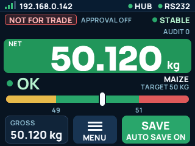

# W-Soft on the small yellow board (`wsoft_cyd28`)

Sunton ESP32-2432S028 ("Cheap Yellow Display", CYD): ESP32-WROOM-32, 4 MB flash, no PSRAM,
2.8" 320x240 panel (ST7789 on the TPM408-2.8 batch, ILI9341 on older ones) with XPT2046 touch (touch not used). Same W-Soft code as the Waveshare
build ([WSOFT-WAVESHARE43.md](WSOFT-WAVESHARE43.md)): approval, Hub queue, DJB poll,
web pages. Only the panel drawing and the pins differ (`WSOFT_BOARD_CYD` in
`lib/wsoft_esp/src/wsoft_screen.cpp`).

> Nothing on this device is legal for trade. Approval stays OFF until Rhyno switches it on
> over USB.

## 1. RS485: needs an add-on

The CYD has no RS485 transceiver. Use a **3.3 V TTL-to-RS485 module with automatic
direction** (no DE/RE pin to drive). Wire it to the **CN1** connector:

| CN1 pin | Module pin |
|---|---|
| 3V3 | VCC |
| GND | GND |
| GPIO22 | the module's TX / TXD / "RO" output (data **from** the box) |
| GPIO27 | the module's RX / RXD / "DI" input (data **to** the box) |

Module A/B go to the junction box A/B. The pins are build flags (`WSOFT_RS485_RX`,
`WSOFT_RS485_TX`); GPIO22/27 are the CN1 pads the `cyd28` env already used for a scale UART.
**Check the module's own labels before power-on**: some modules name TX/RX from their
own side, some from the ESP's side. If the screen stays on `NO SIGNAL`, swap the two data
wires (it cannot damage a 3.3 V module).

Only one RS485 master on the pair: unplug any other reader (Pi, Waveshare) from the box first.

## 1b. RS232 scale instead of the junction box

W-Soft → **Settings** → **Weight comes from**: *Junction box (RS485)* (default) or
*RS232 scale*. Saving a new choice restarts the board (both use the same UART on CN1).

In RS232 mode the existing **Serial reader** (`SerialService`, the same one the other
Hardware.Base boards use) owns the UART on CN1 (`SERIAL2_RX_PIN=22`, `SERIAL2_TX_PIN=27`).
Set the scale's baud, data bits, parity and the **weight pattern** (a regex whose first
group is the number) on the **Serial** page. W-Soft takes that extracted text, parses it
(`wsoft_parse_weight_text`: sign, digits, `.` or `,`, up to 4 decimals; anything else is
not a weight), and runs the same screen, stability and approval checks on it. Unit is kg;
there is no box alarm. A line older than 3 s is `NO SIGNAL`. DJB register jobs
(`/rest/djb`) answer 409 `NO_CARD` ("No weighing card: the scale is on RS232."). The scale
setup is then set on the indicator, so Approval can go ON without a board setup.

**The CYD has no RS232 chip.** Its `P1` plug (VIN/TX/RX/GND) is 3.3 V serial and shares
the USB line. A real RS232 scale (up to ±12 V) needs a **3.3 V RS232-to-TTL converter
(MAX3232)** on CN1: converter TTL side to CN1 like the RS485 module above, DB9 side to the
scale.

## 2. Screen (320 x 240)

The same screen as on the Waveshare, in the look of the Edge bench screen, light or dark:
[WSOFT-SCREEN.md](WSOFT-SCREEN.md) says what every part shows, how MENU and the Wi-Fi alert work,
how it is built and how to check a board over USB (`SCREEN CRC`, `SCREEN SHOT`, `SCREEN TAP`).

This board has no memory for a whole frame. A row of the screen is drawn 16 lines at a time and
pushed over SPI; a row is drawn again only when what it shows changed, so nothing flickers.

CYD batches use different panel controllers. The env defaults to the TPM408-2.8 bench
board: `-DST7789_DRIVER=1`, `-DTFT_RGB_ORDER=TFT_BGR`, `WSOFT_CYD_ROTATION=3`,
`WSOFT_CYD_INVERT=0`.

| What the screen shows | Change |
|---|---|
| Sideways, cut off, a noisy strip on one side | wrong controller: swap `ST7789_DRIVER` / `ILI9341_DRIVER` |
| The colours are the negative of the pictures in [img/wsoft-screen](img/wsoft-screen) (a pale status bar; a white screen in dark mode) | flip `WSOFT_CYD_INVERT` |
| Upside down | `WSOFT_CYD_ROTATION=1` |
| Red shows as blue | flip `TFT_RGB_ORDER` between `TFT_BGR` and `TFT_RGB` |

First flash (3 Nov 2026) with ILI9341 + invert on drew sideways, clipped, with an 80 px
noise strip and a dark background.

## 2b. Weighings for the Hub

A weighing is saved when someone taps **SAVE** (on the screen, or **Save weighing** on the
web Live page), or by itself when **Auto save** is on (the switches: screen MENU, the web page, the Hub or
`/rest/wsoftSwitches`; off by default, kept in NVS `weigh`).
Either way only once the weight has settled above zero for 1 s, and once per load: a new
load needs the scale back at **0** first (also after a restart). A changed weight alone is
not a new load (Rhyno, 8 Nov 2026). Saved whether trade checks are on or
not; the payload carries `for_trade`.

- The SAVE button shows `SAVED #n`, or why not (`Wait: moving`, `Already saved`, `Take load off`,
  `Scale is empty`, `No scale signal`, `Clock not set`, `Memory full`) for 3 s, then how
  many wait for the Hub. After a save it says `Take load off` while that load stays on.
- **Big notice over the weight** (Rhyno, 9 Nov 2026): whenever something stops a save, a
  band across the top of the card says what to do and why, without a tap. Red = nothing saves
  until you act: `TAKE THE LOAD OFF` (the scale must show 0 kg first, also after a restart),
  `NO SCALE SIGNAL`, `CLOCK NOT SET`, `OUT OF RANGE`, `BELOW MIN`, `MEMORY FULL`. Yellow =
  `OUTSIDE HI-LO LIMITS` (tap SAVE twice) or `WEIGHT IS MOVING` (only after 3 s of movement).
  A load still on the scale since boot says `TAKE THE LOAD OFF` even while it moves. The web
  Live page shows the same words in a big alert (`notice_*` fields of the status). Rules and
  words: `WsoftWeighingSaver::waiting()` and `wsoft_save_notice()` in `lib/wsoft_core`.
- Up to 32 unsent weighings are kept in flash (NVS `weigh`). When full, Save answers
  `Memory full` until the Hub takes some: nothing is overwritten.
- Each goes to `POST /api/v1/ingest/weighings` within ~5 s when the Hub is online:
  `weighing_id` = `<MAC>-<unix time>-<seq>`, gross = net = the weight in kg, tare 0,
  basis `GS`; with a tare on (RS485), gross / tare / net and basis `NT`. 201/200 remove it from the board.
- Touch: XPT2046 on HSPI (CLK 25, MISO 39, MOSI 32, CS 33, IRQ 36), no extra library.
  Each tap logs `TOUCH raw=x,y,z screen=x,y` on USB. The same touch drives MENU and the menu pages. If taps land in the wrong
  place on another batch, set `WSOFT_TOUCH_ROTATION` or `WSOFT_TOUCH_X_MIN/MAX`,
  `WSOFT_TOUCH_Y_MIN/MAX` in the env.
- `GET /rest/wsoftSave` (logged in): pending count and last saved. `POST` saves now
  (200, or 409 with `result`).

## 2c. Switches, PIN and scale setup

Same as the Waveshare guide, section 4b (`docs/WSOFT-WAVESHARE43.md`): the endpoints, the
PIN rules, the RS485 setup keys and the Hub commands are shared code. Calibrate, backup Hub
addresses and the alarm test switch are there too (section 4c). The rules for every W-Soft
board are in section 0 of that guide.

## 2d. Hi-Lo relays (LOW / OK / HIGH)

The board can switch three relays from the Hi-Lo check: one for TOO LOW, one for OK, one for
TOO HIGH (a light tower, a buzzer, a gate). **Built, not bench-tested yet (11 Nov 2026).**

**Pins.** The CN1 plug is taken by the scale, so the relays use the pads of the small RGB
LED. Pin list: witnessmenow/ESP32-Cheap-Yellow-Display `PINS.md` (community list, read
11 Nov 2026). It has not been checked on our bench board: do the click test below first.

| Relay | Default job | Pin | LED pad | Build flag |
|---|---|---|---|---|
| 1 | TOO LOW | GPIO17 | blue | `RELAY1_PIN` |
| 2 | OK | GPIO16 | green | `RELAY2_PIN` |
| 3 | TOO HIGH | GPIO4 | red | `RELAY3_PIN` |
| 4 | not fitted | none | none | `RELAY4_PIN=-1` |

- The pads are **active low** (`RELAY_ACTIVE_LOW=1`): pin LOW = relay ON, and the LED colour
  lights with it. The pads rest HIGH, so the relays stay OFF while the board starts and after
  a restart.
- Use a relay module with **opto inputs that switch on a LOW level** and accept 3.3 V logic.
  Give the relay coils their **own 5 V supply**; never power coils from the board's 3V3 pin.
  Join the grounds as the module's manual says.
- Wiring per relay: LED pad to the module input (IN1 / IN2 / IN3). Soldering is needed: the
  pads are on the LED, not on a plug.
- The LED example is not created on this board (its pin, GPIO17, is relay 1). Its menu page
  gets 404.

**When a relay is ON.** Only one Hi-Lo relay at a time, and only when all of this is true:
the switch below is on, the scale answers, no alarm, the reading is not blanked, a Hi-Lo
product is picked, and something is on the scale (above 0). Anything else: all three OFF.
An empty scale is OFF, not TOO LOW.

- A new zone must show on two polls in a row (about 0.5 s) before a relay changes, so a
  weight on a limit does not make it chatter. Going OFF is never delayed.
- The old relay goes OFF before the new one goes ON.
- If the screen task stops posting for 2 s (stuck, or a W-Soft update running), the relays
  go OFF.
- The relays follow the **live** weight, moving or steady. The saved weighing still uses its
  own rules (section 2b).

**Settings** (browser, W-Soft > Settings, admin; saved in `/config/wsoftSettings.json`):

| Field | Default | Meaning |
|---|---|---|
| `relay_enabled` | `false` | Switch the Hi-Lo relays. OFF until someone turns it on |
| `relay_low` / `relay_ok` / `relay_high` | 1 / 2 / 3 | Relay for each zone, 0 = none. No relay twice (the save is refused otherwise) |

Rules in `lib/wsoft_core/src/wsoft_relay.*` and `wsoft_settings.*` (host tests
`test_wsoft_relay`, `test_wsoft_settings`). On a board without relays (the Waveshare)
`relay_available` is false and `relay_enabled: true` is refused.

**Endpoints** (same paths and relay names as the relay board firmware, branch
`RelayBoardEspBuildIn`; here both need a login, because a relay can be a gate):

| Endpoint | Who | What |
|---|---|---|
| `GET /rest/relayBoard` | logged-in user | `{"relay1":..,"relay2":..,"relay3":..,"relay4":..,"di1":false,"di2":false}` |
| `POST /rest/relayBoard` | logged-in user | Switch the relays named in the body. While Hi-Lo drives, its relays are set back on the next pass |
| `GET /rest/relayBoardStatus` | logged-in user | Pins, active level, `hilo` (switch, map, zone now) and `relays` |
| `/ws/relayBoard` | logged-in user | The same state, live |

Not ported from the relay board firmware: the MQTT switch, the digital inputs, the 3D page.
Edge's relay driver expects no login, so it cannot switch these relays as they are; the
board drives them itself.

**Bench click test (before any real load is wired):**

1. Flash, open W-Soft > Settings. Leave "Switch the Hi-Lo relays" **off**.
2. In "Relay test" tap Relay 1, 2, 3 in turn. Each must click, and the LED must show blue,
   green, red. A relay that clicks when it shows OFF means the module is the other way
   round: set `RELAY_ACTIVE_LOW=0` in the env and build again (then the LED colours are
   inverted and a relay may click once at boot: prefer a low-level module).
3. Switch all three off. Tick "Switch the Hi-Lo relays" and save.
4. Pick a Hi-Lo product, put a load on: below the low limit relay 1, inside relay 2, above
   relay 3. Take the load off: all OFF. Pull the scale cable: all OFF once the screen shows NO SIGNAL (a few seconds).
5. Only then wire the real light or gate. A switched relay proves the pin, not the contact.

## 3. Build and flash (laptop)

1. `pio test -e native` (host tests).
2. `pio run -e wsoft_cyd28`.
3. Plug the CYD's **micro-USB** (CH340, `COM15` on Rhyno's laptop) and flash:
   `pio run -e wsoft_cyd28 -t upload`. This replaces the firmware on the board. Flashing is an
   ASKED gate: only with Rhyno's go.
4. `pio device monitor -b 115200`: expect `weigh screen boot`, `display ready`, then
   `DJB ... LIVE` lines once the RS485 module is wired.
5. Wi-Fi and passwords: same as the Waveshare guide, section 2 step 5 (AP
   `Weighsoft-Esp-Reader` (the name follows the UART mode: `-Reader`, `-Writer`, or `-NEW` when unset; see `composeApSsid` in `src/main.cpp`), `http://192.168.4.1`, change the admin and AP passwords).

## 4. Known gaps

- Built in the cloud only; not yet run on a CYD. Bench steps above are still to do.
- Touch is SAVE, MENU and the menu pages. Settings and the scale setup are on the web pages.
- GPIO2 is the screen's DC line, so the LED example drives the blue RGB LED (GPIO17) here.
- Host tests ran in the cloud with a stand-in Unity (the PlatformIO registry was not
  reachable there); run `pio test -e native` on the laptop for the real runner.
- 4 MB flash: single-app `partitions_ble.csv` (3.25 MB app, no OTA). The ~2.0 MB build does not fit the 1.75 MB slots of `partitions_4mb_ota.csv`. Update over USB.
