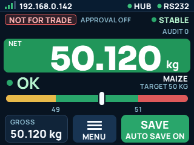
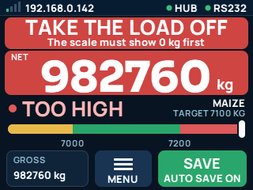
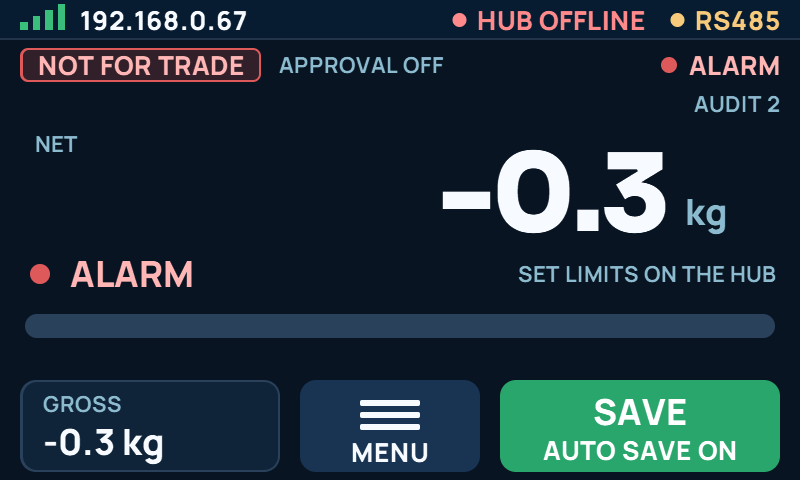
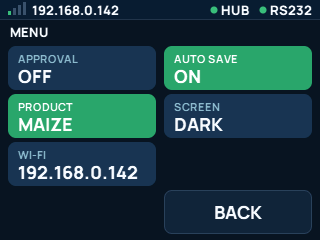
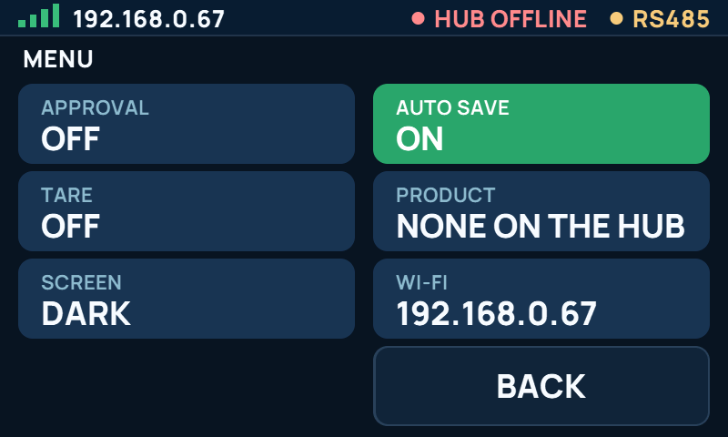

# The W-Soft board screen

One screen layout for every W-Soft board with a panel: the yellow CYD 2.8" (320 x 240,
`wsoft_cyd28`) and the Waveshare 4.3" (800 x 480, `wsoft_waveshare43`). The look follows the
Weighsoft Edge bench screen. Design: [spec](superpowers/specs/2026-11-13-wsoft-screen-redesign-design.md).
Pictures of every test screen on both panels: [img/wsoft-screen](img/wsoft-screen).



## 1. The live page

| Part | Shows |
|---|---|
| Status bar | Wi-Fi bars and the board's address, or `NO WI-FI` in red. `HUB` with a dot: green online, red with its state when not, grey `HUB SETUP` before pairing. The scale source (`RS485`, `RS232`, `WRITER`) with a dot: green live, red no signal, yellow alarm |
| Trade row | `TRADE CHECKS ON` (green) or `NOT FOR TRADE` (red), then why, `SEQ n` or `APPROVAL OFF`. `STABLE` / `UNSTABLE` / `ALARM` / `NO SIGNAL`. Under it the plate (`SA ...   MAX ... MIN ... E ... KG`) once the RS485 setup has one, and `AUDIT n` |
| The band | Takes the trade row's place when needed, first match wins: a red save notice (nothing saves until the person acts), the Wi-Fi alert, a yellow save notice. Same words as the Edge and the web page |
| Weight | `NET` or `NET (TARE)`, the net weight, the unit. `----` when the reading is blanked or no weight arrives. **The panel is yellow, green or red with the Hi-Lo relay zone** (LOW, OK, HIGH) and plain when the relays are off |
| Hi-Lo | The word (`TOO LOW`, `OK`, `TOO HIGH`; else `WAITING`, `ALARM`, `NO PRODUCT`, `OUT OF RANGE`, `EMPTY`), the product and its target, the LOW / OK / HIGH bar with the marker and both limits |
| Bottom | `GROSS` read-out, **MENU**, **SAVE** with its result line (`SAVED #n`, `TAP AGAIN: SAVE`, `TAKE LOAD OFF`, `n TO SEND`, `AUTO SAVE ON`, `TAP TO SAVE`, `WRITER: NO SAVE`) |

The weight panel and the word use `relay_zone()`, the zone the relays are driven with, so the
screen and the relays always agree. The relays (and so the colour) are off unless a product is
picked, the weight is live and above zero, and no alarm or blanking is on. The zone is judged
on the net weight, like the saved weighing.

## 2. Wi-Fi

- The address and signal are always on the status bar.
- Wi-Fi down for 15 s after start, or lost later: a yellow alert, `WI-FI IS OFF`, with
  **CONNECT** and **X**. X hides it until Wi-Fi has been up again.
- CONNECT, a tap on the Wi-Fi part of the status bar, or MENU > WI-FI open the Wi-Fi page: the
  board's hotspot name, the address to open and what to tap. The firmware keeps looking for
  its saved Wi-Fi by itself, so there is no retry button. Connected: the page shows the address.
- A red `CLOCK NOT SET` notice opens the same page while Wi-Fi is down.
- The screen never shows a password.

## 3. MENU

Each tile shows what it is set to now; green is on. APPROVAL (asks for the screen PIN on a
phone-style pad; with no PIN set, a note says where to set it), AUTO SAVE, TARE and PRESET
TARE (RS485 only), PRODUCT (steps through the Hub's Hi-Lo products), SCREEN (dark or light,
kept in flash: NVS `wsoft_ui` / `dark`), WI-FI, BACK. The top right line says what the last
tap did. After 30 s without a tap the screen goes back to the live page (the Wi-Fi page after
3 minutes).

## 4. How it is built

| Layer | Where | What |
|---|---|---|
| Words | `lib/wsoft_core/src/wsoft_ui_model.*` | From the facts (scale, trade, Hi-Lo, relay zone, save state, Wi-Fi, Hub) to a `WsoftUiModel`: every word and state on the screen. Every rule about what the screen says is here |
| Layout | `lib/wsoft_core/src/wsoft_ui_paint.*` | Paints a model row by row in a 320 x 240 layout; the tap boxes; `wsoft_ui_row_key` says when a row must be painted again |
| Drawing | `lib/wsoft_core/src/wsoft_gfx.*` | Round boxes, discs and letters into 16-bit dots, into a whole frame or one band of lines |
| Generated | `lib/wsoft_core/src/gen/` | Letters for each panel size, the colours, the test screens |
| Board | `lib/wsoft_esp/src/wsoft_ui.*` | Reads the facts every poll, paints the rows that changed, pages and taps, each board's panel and touch |

The first three layers are pure C++ and run in the host tests. The yellow board has no memory
for a frame: a row is drawn 16 lines at a time and pushed over SPI, each band complete, so
nothing flickers. The Waveshare draws into a frame in PSRAM and pushes it whole. The
Waveshare scales the layout 2.5 x 2 with letters twice the size.

Letters: Manrope (words) and Sora (the weight), both under the SIL Open Font License 1.1,
drawn once into 4-bit coverage maps by `tools/wsoft-ui/gen.mjs`. About 28 KB on the yellow
board and 100 KB on the Waveshare.

## 5. The reference drawing and the tests

`tools/wsoft-ui/ref.js` is the screen as it must look, runnable in a browser: the same
drawing engine, layout, colours and test screens. The firmware paint code is its
line-for-line port.

| Command | Does |
|---|---|
| `node tools/wsoft-ui/gen.mjs` | Runs `ref.js` in headless Edge or Chrome and writes the letters, colours, test screens, `test/test_wsoft_ui/golden.h` (the CRC-32 of every test screen), the pictures in `docs/img/wsoft-screen` and the mock-up page `tools/wsoft-ui/out/mockup.html`. Needs the internet for the fonts |
| `pio test -e native -f test_wsoft_ui` | Paints every test screen on both panel sizes, whole and in bands, and holds each to its CRC; tests the wording rules, the row keys, the tap boxes and the engine. Needs a host g++ on PATH (`%USERPROFILE%\.platformio\packages\toolchain-gccmingw32\bin` on the laptop) |
| `powershell -File tools/wsoft-ui/shoot.ps1 0 1 2` | Pictures of test screens from the mock-up page, to look at |

Change the look in `ref.js` first, run `gen.mjs`, see `test_wsoft_ui` fail, then change
`wsoft_ui_paint.cpp` the same way until it passes.

## 6. Checking a board over USB

USB technician commands (115200 baud, the board's log port), handled by `ui_handle_command`:

| Command | Does |
|---|---|
| `SCREEN CRC` | Paints every test screen on the board and prints `SCREEN_CRC n XXXXXXXX`. They must equal `golden.h` |
| `SCREEN SHOT` | Sends the screen as it is now as run-length text |
| `SCREEN SHOT n` | Sends test screen n |
| `SCREEN PIXEL x y` | One dot as the panel has it (panel dots). The yellow board reads it back from the panel's own memory, so it proves what is on the glass; the Waveshare answers from its frame |
| `SCREEN TAP x y` | A tap at layout position x, y (320 x 240), the same as a finger |

`tools/wsoft-ui/shot.ps1` runs them and saves the pictures:

```
powershell -File tools/wsoft-ui/shot.ps1 -Port COM13 -Panel yellow -Do CRC,SHOT
powershell -File tools/wsoft-ui/shot.ps1 -Port COM11 -Panel wave -Do "TAP 156 213",SHOT
```

**Bench use only, with the scale idle.** While the test screens are painted (a few seconds) or a
picture is sent (about 10 s on the yellow board, longer on the Waveshare) the weigh loop waits:
the relays rest because their zone goes stale, the web page, MQTT and a Writer keep the last
weight, and a save or switch from the web page times out. `SCREEN TAP` can do whatever a finger
can, SAVE included. A log line from another task can land inside a picture; `shot.ps1` then
reports a checksum that differs and takes the picture again.

`shot.ps1 -Do SHOT,GLASS` reads 48 dots back from the yellow board's panel and holds them to the
picture: the only check of the glass itself that needs nobody at the board. If the panel does
not answer reads, it says so; that is not a fault of the screen.

## 7. On the two bench boards (14 Nov 2026)

Both boards were flashed with commit `cc41e7a` (app only at 0x10000, nothing erased) and checked
over USB with `shot.ps1`. Pictures sent by the boards themselves:

| Yellow board, COM13, MAC 6c:c8:40:45:60:f4 | Waveshare, COM11, MAC 94:a9:90:02:96:68 |
|---|---|
|  |  |
|  |  |

| Check | Yellow board | Waveshare |
|---|---|---|
| Boots, settings kept (source, Wi-Fi, Hub pairing, product, auto save) | yes | yes |
| `SCREEN CRC`: all 25 test screens equal `golden.h` | yes | yes |
| `SCREEN TAP`: MENU, SCREEN light and back, WI-FI page, status bar tap, BACK | yes | yes |
| `GLASS`: 48 dots read back from the panel equal the picture | yes, 48 of 48 | not possible on this panel |
| Firmware size | 2,261,952 of 3,407,872 bytes (66%) | 2,642,480 of 6,553,600 bytes (40%) |
| Not checked: a finger on the touch screen, and eyes on the Waveshare glass | | |

The yellow board showed a red TOO HIGH panel because its RS232 line was sending 982760 kg
against Maize at 7000 to 7200 kg; the Waveshare showed ALARM because its junction box
reports a blocking alarm at -0.3 kg. Both are the boards' real inputs that night.

## 8. Known gaps

- No Wi-Fi setup on the screen itself: the phone steps only.
- The saver's "the scale must show 0 first" rule looks at the gross weight; the screen's EMPTY
  and the relays look at the net. With a tared container left on, the screen says NET 0 and
  EMPTY while the red note says TAKE THE LOAD OFF.
- The Wi-Fi alert comes back at every start without Wi-Fi until X is tapped.
- A panel that fails to start still stops the weigh loop on a board with a screen
  (`wsoft_screen_loop`), as before.
